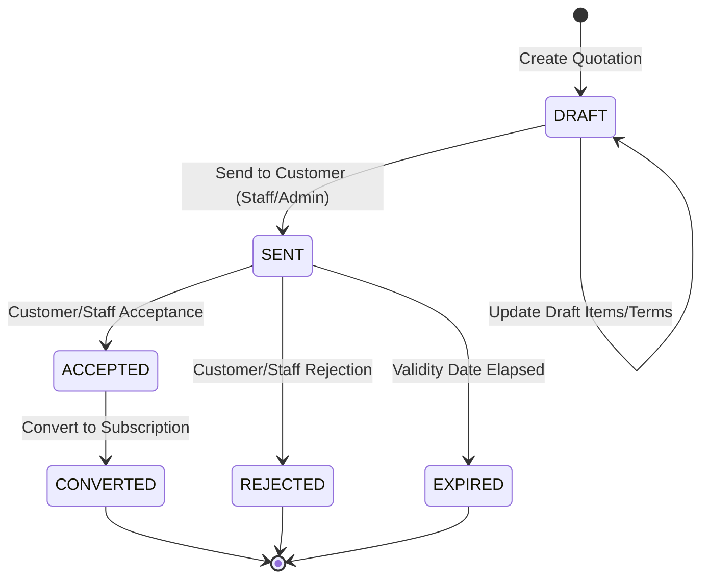
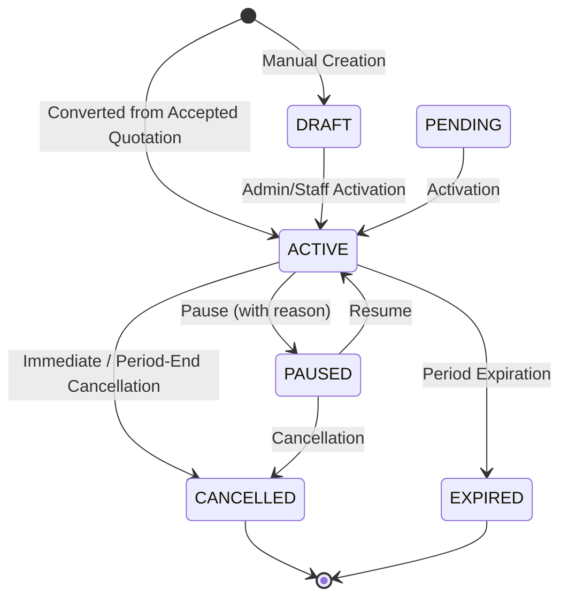

# Brightloop SMS — Developer 2 Handover & Integration Guide

**Author:** Developer 2 (Commercial Lifecycle Lead)  
**Target Audience:** Developer 1 (Platform Lead), Developer 3 (Tax, Discounts, Payments & Dashboard Lead)  
**Module Scope:** Quotations, Subscriptions, Recurring Billing Engine, Invoices  
**Version:** `1.0.0-complete`  
**Test Suite Status:** 5 suites, 50 tests passing (100% pass rate)

---

## 1. Executive Summary & Architecture Compliance

Developer 2 was tasked with implementing the full commercial lifecycle for Brightloop Software's Subscription Management System:
$$\text{Customer} \longrightarrow \text{Quotation} \xrightarrow{\text{Accept}} \text{Subscription} \xrightarrow{\text{Recurring Engine}} \text{Invoice} \xrightarrow{\text{Developer 3}} \text{Payment}$$

### Architecture & Conventions Followed:
1. **Strict Monolith & Stack Consistency:** Built entirely inside the existing monorepo with Node.js/Express, Next.js 14, TypeScript, Prisma ORM, and PostgreSQL. No foreign databases, microservices, or external queue dependencies were introduced.
2. **Prisma Schema Ownership:** Honored Developer 1's ownership of `database/schema.prisma`. No models or enums were modified or duplicated.
3. **Integer Money Representation:** All monetary amounts are handled strictly as `BIGINT` in minor currency units (paise for INR) on the database and backend, and serialized as decimal strings (`amountMinor: "250000"`) across API envelopes. Zero floating-point math is used.
4. **Standard API Response Envelopes:** All endpoints return `{ success: true, data: ..., meta: ..., error: null }` using `AppResponse`.
5. **RBAC & Customer Ownership:** All endpoints enforce JWT authentication and role-based permissions (`ADMIN`, `STAFF`, `CUSTOMER`). Customer ownership is validated at the service layer so customers can never view or manipulate entities belonging to other tenants.
6. **Clean Developer 3 Integration Surface:** Provided modular, decoupled service methods for tax and discount calculations (`PricingCalculationService.calculateTotals`) and payment allocation tracking (`InvoiceService.recordPaymentAllocation`).

---

## 2. Shared Database Models & Developer 1 Confirmations

All database tables and relations defined by Developer 1 in `database/schema.prisma` were utilized as intended:

| Model | Purpose | Developer 2 Status |
| :--- | :--- | :--- |
| `Quotation` | Customer quote document with commercial terms, validity, and status | Fully implemented with atomic transitions |
| `QuotationItem` | Individual product/variant line items on a quotation | Fully implemented with frozen unit prices |
| `QuotationTemplate` | Reusable terms, conditions, and validity configurations | Fully implemented with CRUD |
| `Subscription` | Recurring customer subscription with billing intervals and dates | Fully implemented with lifecycle controls |
| `SubscriptionItem` | Plan / product line items tied to an active subscription | Fully implemented with fractional quantities |
| `BillingRun` | Audit record of a scheduled or manual recurring billing engine execution | Fully implemented with processing metrics |
| `BillingAttempt` | Per-subscription outcome record for a billing run | Fully implemented with error and success tracking |
| `Invoice` | Formal billing document issued to customers | Fully implemented with status tracking & voiding |
| `InvoiceItem` | Immutable, frozen line item snapshot created at invoice issue time | Fully implemented |
| `AuditLog` | Structured platform event audit log (Contract D) | Integrated across all lifecycle state mutations |

### Essential Database Index (Confirmation)
In accordance with `docs/database.md`, the partial unique index guaranteeing billing idempotency is active in PostgreSQL:
```sql
CREATE UNIQUE INDEX IF NOT EXISTS uq_invoice_subscription_period
ON invoices ("subscriptionId", "billingPeriodStart", "billingPeriodEnd")
WHERE "subscriptionId" IS NOT NULL;
```

### Concurrency-Safe Sequential Identifiers
To prevent race conditions and duplicate number collisions under concurrent requests, identifiers are generated via database-backed sequences managed by `SequenceService` (`backend/src/utils/sequence.service.ts`):
- Quotations: `QUO-YYYY-XXXX` (e.g. `QUO-2026-0001`)
- Subscriptions: `SUB-YYYY-XXXX` (e.g. `SUB-2026-0001`)
- Invoices: `INV-YYYY-XXXX` (e.g. `INV-2026-0001`)

The service automatically inspects existing records on startup and executes `setval()` to ensure existing records from seeds or tests never conflict.

---

## 3. Quotation Management Module

### Lifecycle State Machine


### Quotation Features Implemented:
1. **Creation & Drafting:**
   - Admin and Staff can create quotations for any existing customer.
   - Multi-item support with product and variant resolution, custom unit prices, and fractional quantities.
   - Optional template application to populate default terms and validity duration.
2. **Security & Ownership:**
   - Admin and Staff have global read/write access.
   - Customers can list and view only their own quotations. Customer IDs supplied by the frontend are strictly checked against the authenticated user's linked customer record.
3. **Transitions & Conversion:**
   - Strict transition guards prevent modifying non-draft quotations, accepting expired quotations, or re-converting converted quotations.
   - Conversion to a subscription is transactional (`prisma.$transaction`). It creates the subscription, duplicates line items into `SubscriptionItem`, links the source quotation, and sets quotation status to `CONVERTED`.

---

## 4. Subscription Management Module

### Lifecycle State Machine & Invariants


### Business Rules & Invariants:
1. **Paused Subscriptions:** Never generate recurring invoices while paused.
2. **Cancelled Subscriptions:** Never generate recurring invoices beyond their effective cancellation date. Reactivation is prohibited to maintain billing integrity.
3. **Anchor Day Preservation:** Subscriptions preserve their original anchor day (e.g., a subscription starting on January 31 will bill on February 28/29, but return to March 31).
4. **Fractional Quantities:** Supported via Prisma `Decimal` / PostgreSQL `NUMERIC(12,3)`.

---

## 5. Recurring Billing Engine

The billing engine (`backend/src/services/billing.service.ts` and `backend/src/services/billing-period.ts`) provides fully automated and manual billing cycle execution.

### Billing Period Utilities (`billing-period.ts`)
- **Convention:** Start-inclusive, end-exclusive interval: `[periodStart, periodEnd)`.
- **Supported Intervals:** `DAILY`, `WEEKLY`, `MONTHLY`, `YEARLY`.
- **Leap Year & Month-End Handling:** Deterministic date math utilizing UTC boundaries. February leap years (`2024`, `2028`) accurately use day 29, while non-leap years use day 28.
- **Anchor Day Logic:** When calculating `MONTHLY` or `YEARLY` intervals, the original billing anchor is passed forward to prevent calendar drift.

### Recurring Engine Workflow (`BillingService.executeBillingRun`)
1. **Target Date Filter:** Queries all `ACTIVE` subscriptions where `nextBillingDate <= targetDate`.
2. **BillingRun Initialization:** A master `BillingRun` record is created in `PROCESSING` state.
3. **Transactional Isolation per Subscription:**
   - Checks if an invoice already exists for `(subscriptionId, currentPeriodStart, currentPeriodEnd)`.
   - If an invoice exists (e.g. from an earlier interrupted run), the engine safely records a `SUCCESS` attempt, skips invoice recreation, and advances the subscription period.
   - Calls `PricingCalculationService.calculateTotals` to determine subtotal, taxes, and discounts.
   - Generates sequential invoice number (`INV-YYYY-XXXX`).
   - Creates `Invoice` with `ISSUED` status and dueDate (defaulting to 15 days from period start).
   - Creates immutable `InvoiceItem` records snapshotting the product name, variant name, description, unit price, quantity, and tax amounts.
   - Advances subscription `currentPeriodStart`, `currentPeriodEnd`, and `nextBillingDate` to the next cycle.
   - Records individual `BillingAttempt` (`SUCCESS` or `FAILED`).
4. **BillingRun Completion:** Computes summary counts (`processedSubscriptionsCount`, `successfulInvoicesCount`, `failedInvoicesCount`) and marks `BillingRun` as `COMPLETED` (or `FAILED` if a fatal failure occurs).

---

## 6. Invoice Management Module

### Invoice Lifecycle
- `DRAFT` $\rightarrow$ Initial creation (if manual).
- `ISSUED` $\rightarrow$ Formal invoice generated and awaiting payment.
- `PARTIALLY_PAID` $\rightarrow$ One or more payments recorded, balance remains $> 0$.
- `PAID` $\rightarrow$ Full amount paid (`balanceDueMinor === 0n`).
- `VOID` $\rightarrow$ Cancelled unpaid invoice.
- `CANCELLED` / `OVERDUE` $\rightarrow$ Lifecycle support.

### Immutable Snapshots & Safety Rules:
- **Price Freezing:** Line items freeze product descriptions, SKUs, and unit prices as they existed at invoice generation time. Later changes to product pricing will never alter historical invoices.
- **Voiding Protections:** Invoices that have `status === PAID` or have recorded payment allocations cannot be voided.
- **Print View:** Dedicated, clean print view at `/admin/invoices/[id]/print` with automated print styling (`@media print`), omitting navigation headers and sidebar.

---

## 7. Developer 3 Integration Interfaces

Developer 3 owns taxes, discounts, payments, and dashboards. Developer 2 has exposed two clean, decoupled integration surfaces:

### 1. Pricing, Tax & Discount Calculation Interface
**Location:** `backend/src/services/pricing-calculation.service.ts`  
**Method:** `PricingCalculationService.calculateTotals(input: PricingCalculationInput): Promise<CalculationResult>`

```typescript
export interface PricingLineItemInput {
  productId?: string | null;
  productVariantId?: string | null;
  description: string;
  quantity: string | number;
  unitPriceMinor: bigint | string | number;
}

export interface PricingCalculationInput {
  customerId: string;
  currency?: string;
  items: PricingLineItemInput[];
  discountCode?: string | null;
  billingPeriodStart?: Date | null;
  billingPeriodEnd?: Date | null;
}

export interface CalculatedLineItem {
  productId?: string | null;
  productVariantId?: string | null;
  description: string;
  quantity: string;
  unitPriceMinor: bigint;
  taxAmountMinor: bigint;
  totalAmountMinor: bigint;
  taxRateBasisPoints: number;
}

export interface CalculationResult {
  subtotalMinor: bigint;
  taxAmountMinor: bigint;
  discountAmountMinor: bigint;
  totalAmountMinor: bigint;
  items: CalculatedLineItem[];
  appliedDiscount?: {
    id: string;
    code: string;
    amountMinor: bigint;
  } | null;
}
```

*Developer 3 Note:* The baseline calculation automatically resolves active rates from the `TaxRate` table and applies active coupons from the `Discount` table. Developer 3 can enhance this class without altering the caller signature in Quotation, Subscription, or Billing services.

### 2. Payment Allocation Interface
**Location:** `backend/src/services/invoice.service.ts`  
**Method:** `InvoiceService.recordPaymentAllocation(invoiceId: string, allocatedAmountMinor: bigint): Promise<Invoice>`

When Developer 3 processes a customer payment and allocates funds to an invoice, call this method:
```typescript
import { InvoiceService } from "../services/invoice.service";

// Inside Developer 3's payment allocation workflow:
const updatedInvoice = await InvoiceService.recordPaymentAllocation(
  invoiceId,
  paymentAmountMinor // e.g. 500000n for Rs. 5,000.00
);
```

**Behavior & Automatic State Transitions:**
- Adds `allocatedAmountMinor` to `invoice.amountPaidMinor`.
- Decrements `invoice.balanceDueMinor`.
- If `balanceDueMinor === 0n` (fully settled): updates `status` to `PAID` and sets `paidAt = new Date()`.
- If `balanceDueMinor > 0n` and `amountPaidMinor > 0n`: updates `status` to `PARTIALLY_PAID`.
- Rejects allocations on `VOID` invoices with `BusinessRuleError`.
- Executes inside a transactional lock for atomicity.

---

## 8. REST API Reference

All routes require `Authorization: Bearer <JWT_TOKEN>`.

### Quotation Endpoints
| Method | Endpoint | Allowed Roles | Description |
| :--- | :--- | :--- | :--- |
| `GET` | `/api/quotations` | `ADMIN`, `STAFF`, `CUSTOMER` | List quotations (Customer scoped to owned records) |
| `POST` | `/api/quotations` | `ADMIN`, `STAFF` | Create quotation (generates `QUO-YYYY-XXXX`) |
| `GET` | `/api/quotations/:id` | `ADMIN`, `STAFF`, `CUSTOMER` | Get quotation details with line items |
| `PATCH` | `/api/quotations/:id` | `ADMIN`, `STAFF` | Update draft quotation |
| `POST` | `/api/quotations/:id/send` | `ADMIN`, `STAFF` | Mark quotation as `SENT` |
| `POST` | `/api/quotations/:id/accept` | `ADMIN`, `STAFF`, `CUSTOMER` | Accept quotation (`SENT` $\rightarrow$ `ACCEPTED`) |
| `POST` | `/api/quotations/:id/reject` | `ADMIN`, `STAFF`, `CUSTOMER` | Reject quotation (`SENT` $\rightarrow$ `REJECTED`) |
| `POST` | `/api/quotations/:id/expire` | `ADMIN`, `STAFF` | Mark quotation as `EXPIRED` |
| `POST` | `/api/quotations/:id/convert`| `ADMIN`, `STAFF` | Convert accepted quotation to active subscription |

### Quotation Template Endpoints
| Method | Endpoint | Allowed Roles | Description |
| :--- | :--- | :--- | :--- |
| `GET` | `/api/quotation-templates` | `ADMIN`, `STAFF` | List quotation templates |
| `POST` | `/api/quotation-templates` | `ADMIN`, `STAFF` | Create quotation template |
| `GET` | `/api/quotation-templates/:id` | `ADMIN`, `STAFF` | Get template by ID |
| `PATCH` | `/api/quotation-templates/:id` | `ADMIN`, `STAFF` | Update template |
| `DELETE` | `/api/quotation-templates/:id` | `ADMIN`, `STAFF` | Delete template |

### Subscription Endpoints
| Method | Endpoint | Allowed Roles | Description |
| :--- | :--- | :--- | :--- |
| `GET` | `/api/subscriptions` | `ADMIN`, `STAFF`, `CUSTOMER` | List subscriptions (Customer scoped to owned records) |
| `POST` | `/api/subscriptions` | `ADMIN`, `STAFF` | Create manual subscription |
| `GET` | `/api/subscriptions/:id` | `ADMIN`, `STAFF`, `CUSTOMER` | Get subscription details, items & billing info |
| `POST` | `/api/subscriptions/:id/activate` | `ADMIN`, `STAFF` | Activate draft/pending subscription |
| `POST` | `/api/subscriptions/:id/pause` | `ADMIN`, `STAFF` | Pause active subscription |
| `POST` | `/api/subscriptions/:id/resume` | `ADMIN`, `STAFF` | Resume paused subscription |
| `POST` | `/api/subscriptions/:id/cancel` | `ADMIN`, `STAFF` | Cancel subscription (immediate or at period end) |

### Recurring Billing Engine Endpoints
| Method | Endpoint | Allowed Roles | Description |
| :--- | :--- | :--- | :--- |
| `POST` | `/api/billing/run` | `ADMIN` | Trigger billing run for subscriptions due by `targetDate` |
| `GET` | `/api/billing/runs` | `ADMIN` | List historical billing engine runs |
| `GET` | `/api/billing/runs/:id` | `ADMIN` | Get billing run details and outcome metrics |
| `GET` | `/api/billing/attempts` | `ADMIN` | List all individual billing attempts |

### Invoice Endpoints
| Method | Endpoint | Allowed Roles | Description |
| :--- | :--- | :--- | :--- |
| `GET` | `/api/invoices` | `ADMIN`, `STAFF`, `CUSTOMER` | List invoices (Customer scoped to owned records) |
| `POST` | `/api/invoices` | `ADMIN`, `STAFF` | Create standalone invoice |
| `GET` | `/api/invoices/:id` | `ADMIN`, `STAFF`, `CUSTOMER` | Get invoice details, frozen items, payment allocations |
| `POST` | `/api/invoices/:id/void` | `ADMIN`, `STAFF` | Void unpaid invoice |

---

## 9. Frontend Pages Implemented

All pages are built with Next.js App Router, Tailwind CSS, Lucide icons, and shadcn UI components:

```
frontend/src/app/admin/
├── quotations/
│   ├── page.tsx               # Quotations directory (search, status filters, action buttons)
│   ├── new/page.tsx           # Create Quotation (customer selection, templates, multi-item table)
│   └── [id]/page.tsx          # Quotation details, terms, Send/Accept/Reject/Convert actions
├── quotation-templates/
│   └── page.tsx               # Template management (Terms, validity periods, default toggle)
├── subscriptions/
│   ├── page.tsx               # Subscriptions table with interval, status badges, quick actions
│   ├── new/page.tsx           # Manual subscription provisioning (Plan or custom items)
│   └── [id]/page.tsx          # Subscription detail, lifecycle controls, associated invoices
├── billing/
│   └── page.tsx               # Engine dashboard: Run Billing modal, KPIs, run history, attempts
└── invoices/
    ├── page.tsx               # Invoices directory with balances, statuses, and print triggers
    ├── [id]/page.tsx          # Invoice view: frozen snapshots, allocations, void action
    └── [id]/print/page.tsx    # Clean, CSS-styled printable invoice (window.print() ready)
```

---

## 10. Verification Test Suite & Results

### Automated Test Coverage
The suite covers all critical paths, business edge cases, and security barriers:
1. `backend/src/__tests__/billing_period.test.ts` (11 tests):
   - Daily, weekly, monthly, and yearly intervals.
   - Anchor day retention (e.g. 31st January $\rightarrow$ 28th February $\rightarrow$ 31st March).
   - Leap year handling (2024 leap year vs 2025 non-leap year).
   - Billing due checks.
2. `backend/src/__tests__/dev2_lifecycle.test.ts` (19 tests):
   - Quotation sequence generation (`QUO-2026-XXXX`).
   - Customer ownership enforcement on quotations.
   - State machine guards: Draft $\rightarrow$ Sent $\rightarrow$ Accepted $\rightarrow$ Converted.
   - Quotation conversion atomicity and duplicate conversion prevention.
   - Subscription lifecycle: Pause prevents billing, Resume restores active status, Cancel terminates billing.
   - Recurring billing engine idempotency: Verifies that running the billing engine twice for the same target date never creates duplicate invoices.
   - Invoice item snapshot preservation.
   - Invoice voiding constraints (disallowing voiding paid invoices).
   - Developer 3 payment allocation integration and automatic status progression.
3. Existing Platform Suites:
   - `auth.test.ts` (5 tests)
   - `authorization.test.ts` (6 tests)
   - `products_plans.test.ts` (9 tests)

### Full Test Execution Output
```
> @sms/backend@1.0.0 test
> jest --runInBand --detectOpenHandles --forceExit

PASS src/__tests__/dev2_lifecycle.test.ts
PASS src/__tests__/auth.test.ts
PASS src/__tests__/authorization.test.ts
PASS src/__tests__/products_plans.test.ts
PASS src/__tests__/billing_period.test.ts

Test Suites: 5 passed, 5 total
Tests:       50 passed, 50 total
Snapshots:   0 total
Time:        7.961 s
Ran all test suites.
```

### Build Verification
- **Shared Package:** `@sms/shared` compiled cleanly (`npm run build --workspace=@sms/shared`).
- **Backend:** `@sms/backend` compiled cleanly with `tsc -p tsconfig.json` (0 errors).
- **Frontend:** `@sms/frontend` compiled cleanly with `next build` (23 routes generated with 0 errors).

---

## 11. Quickstart Commands for Running and Testing

### 1. Database Setup
```powershell
# Ensure local PostgreSQL is running on port 5432
# Push Prisma schema and seed baseline demo data
npm run db:push
npm run db:seed
```

### 2. Run Test Suite
```powershell
# Run the complete Jest test suite
npm run test
```

### 3. Start Development Servers
```powershell
# Start both backend and frontend concurrently
npm run dev

# Or run individually:
npm run dev:backend   # Express API listening on http://localhost:5000
npm run dev:frontend  # Next.js App listening on http://localhost:3000
```

### 4. Default Seed Credentials for Testing
- **Admin User:** `admin@brightloop.demo` / `Admin@123456`
- **Staff User:** `staff@brightloop.demo` / `Staff@123456`
- **Customer User:** `customer@brightloop.demo` / `Customer@123456`

